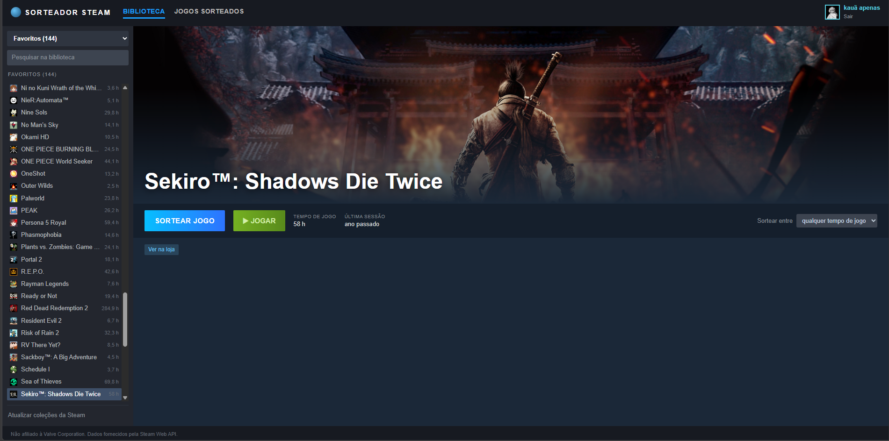
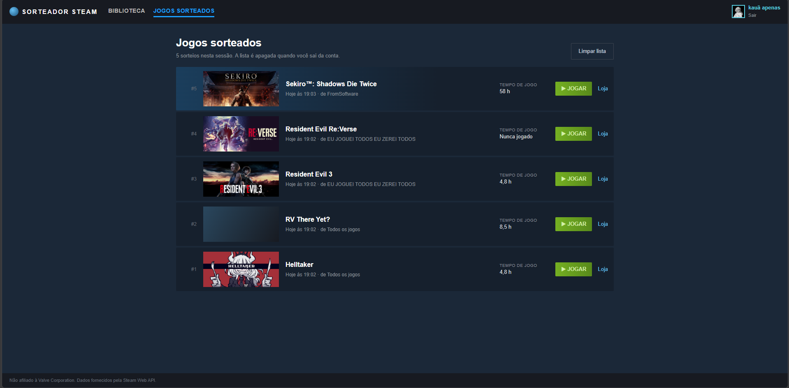

# Sorteador Steam

[🇧🇷 Português](#-português) · [🇺🇸 English](#-english)

**https://sorteador-7242f.web.app**

---

## 🇧🇷 Português

Não sabe o que jogar? Entre com a sua conta Steam, veja a sua biblioteca e deixe o site sortear um jogo.

**Acesse:** https://sorteador-7242f.web.app


*Biblioteca: escolha uma coleção, filtre por tempo de jogo e sorteie. O botão Jogar abre o jogo direto na Steam.*


*Jogos sorteados: histórico da sessão, com a coleção de onde cada jogo saiu.*

O projeto surgiu numa tarde de final de semana em que eu e alguns amigos estávamos em dúvida sobre o que jogar.
Ter uma ferramenta pronta, em vez de colocar os jogos numa roleta manualmente, acaba sendo mais prático.

### Funcionalidades

- **Login com a Steam** (OpenID). A senha é digitada no site da própria Steam; o projeto recebe apenas o SteamID público.
- **Biblioteca** com busca, ícones, tempo de jogo e última sessão, num visual inspirado no cliente da Steam.
- **Sorteio** com animação, sem repetir os últimos 5 jogos sorteados.
- **Filtros de sorteio:** qualquer tempo de jogo, nunca jogados, menos de 2 h ou menos de 10 h.
- **Coleções da Steam:** importe as coleções que você criou no cliente e sorteie dentro de uma delas.
- **Jogos sorteados:** aba com o histórico dos sorteios da sessão, apagado ao sair da conta.
- **Botão Jogar:** abre o jogo direto no cliente Steam (`steam://run/<appid>`).
- **Idiomas:** português, inglês e espanhol, com seletor na barra superior.
- **Dúvidas:** página `/duvidas` com perguntas frequentes sobre login, privacidade e uso, acessível sem login.

### Como usar

1. Acesse o site e clique em **Entrar com a Steam**.
2. Seu perfil precisa ter **Detalhes dos jogos** como **Público**
   (Steam → Perfil → Editar perfil → Configurações de privacidade). Se estiver privado, o site mostra o passo a passo.
3. Clique em **Sortear jogo**. Use o seletor **Sortear entre** para filtrar por tempo de jogo.
4. Para usar suas coleções, clique em **+ Importar coleções da Steam** no rodapé da lista e envie o arquivo
   `cloud-storage-namespace-1.json`. A janela mostra o caminho exato da pasta para o seu sistema.
5. Para trocar o idioma, clique na bandeira no canto superior direito.

#### Privacidade

- O servidor guarda apenas o seu SteamID, num cookie de sessão assinado. Não há banco de dados.
- A lista de jogos é buscada na Steam a cada sessão e fica em cache na memória do servidor por até 1 hora.
- Coleções importadas, o histórico de sorteios e o idioma escolhido ficam só no seu navegador (`localStorage`).
  O arquivo de coleções é lido no navegador e nunca é enviado ao servidor.

### Como funciona

```
Navegador ──► Firebase Hosting (CDN) ── páginas estáticas: /, /sorteados e /duvidas
    │
    └──► /api/*  ──► Cloud Function (Next.js) ──► Steam (OpenID + Web API)
```

As páginas são HTML estático. Ao abrir, o navegador chama `/api/me` para saber se há sessão. Só as rotas `/api/*`
rodam no servidor, porque precisam da chave da Steam Web API, que não pode ir para o navegador.

| Rota | O que faz |
|---|---|
| `GET /api/auth/steam` | Redireciona para o login OpenID 2.0 da Steam |
| `GET /api/auth/steam/callback` | Confirma o login com a Steam (`check_authentication`) e grava o SteamID num cookie httpOnly assinado |
| `POST /api/auth/logout` | Encerra a sessão |
| `GET /api/me` | Retorna o SteamID e o perfil (nome, avatar) da sessão atual |
| `GET /api/games` | Busca a biblioteca com `IPlayerService/GetOwnedGames` (`?refresh=1` ignora o cache) |

APIs da Steam usadas: `IPlayerService/GetOwnedGames`, `ISteamUser/GetPlayerSummaries` e as imagens públicas do CDN
da Steam (`header.jpg`, `library_hero.jpg`).

#### Stack

- [Next.js 15](https://nextjs.org/) (App Router) + React 19 + TypeScript
- [iron-session](https://github.com/vvo/iron-session) para o cookie de sessão
- Firebase Hosting + Cloud Functions (integração de frameworks do Firebase)
- CSS puro, sem bibliotecas de UI
- i18n próprio, sem bibliotecas (`src/i18n`)

#### Estrutura

```
src/
  app/
    page.tsx              página da biblioteca
    sorteados/page.tsx    página de jogos sorteados
    duvidas/page.tsx      perguntas frequentes
    api/                  rotas de servidor (login, sessão, jogos)
    globals.css           todo o visual
  components/
    App.tsx               verifica a sessão e escolhe a tela
    Library.tsx           lista, filtros e sorteio
    History.tsx           jogos sorteados
    Faq.tsx               perguntas frequentes
    CollectionsImport.tsx importação de coleções
    LanguageSwitcher.tsx  seletor de idioma com bandeiras
    TopBar.tsx, LogoutButton.tsx
  i18n/
    messages/             textos da interface: pt-BR.json (referência), en.json, es.json
    config.ts             idiomas registrados, nomes dos idiomas, tradução e plurais
    I18nProvider.tsx      hook useI18n(): t(), textos com tags e formatação de horas e datas
  lib/
    steam.ts              OpenID e Steam Web API
    session.ts            configuração da sessão
    collections.ts        leitura do arquivo de coleções
    history.ts            histórico de sorteios (localStorage)
    limits.ts             filtros de tempo de jogo
    format.ts             endereço do CDN de imagens da Steam
```

### Rodando localmente

Requisitos: Node.js 20 ou superior.

1. Instale as dependências: `npm install`
2. Gere uma chave em https://steamcommunity.com/dev/apikey. No campo de domínio, `localhost` serve.
   A conta Steam não pode ser limitada (precisa ter gastado pelo menos US$ 5 na loja).
3. Copie `.env.example` para `.env.local` e preencha as variáveis abaixo.
4. Rode `npm run dev` e abra http://localhost:3000

| Variável | Descrição |
|---|---|
| `STEAM_API_KEY` | Chave da Steam Web API. Nunca publique. |
| `SESSION_SECRET` | Texto aleatório com 32+ caracteres para assinar o cookie. Gere com `node -e "console.log(require('crypto').randomBytes(32).toString('hex'))"` |
| `APP_URL` | Endereço do site, usado no retorno do login. Local: `http://localhost:3000` |

### Publicando no seu próprio Firebase

O deploy roda o servidor numa Cloud Function, então o projeto Firebase precisa estar no plano **Blaze**
(pago por uso, com cota gratuita). Recomenda-se criar um alerta de orçamento no Google Cloud.

1. Instale a CLI (`npm install -g firebase-tools`) e faça login (`firebase login`).
2. Copie `.firebaserc.example` para `.firebaserc` e coloque o ID do seu projeto, ou rode `firebase use --add`.
3. Ative a integração de frameworks: `firebase experiments:enable webframeworks`
4. Cadastre os segredos (ficam no Google Secret Manager, nunca em arquivo):
   ```sh
   firebase functions:secrets:set STEAM_API_KEY
   firebase functions:secrets:set SESSION_SECRET   # diferente do usado localmente
   firebase functions:secrets:set APP_URL          # https://SEU-PROJETO.web.app
   ```
5. Publique: `firebase deploy --only hosting`

No primeiro deploy a CLI pode pedir para ativar APIs do Google Cloud (Cloud Functions, Cloud Build, Artifact Registry,
Cloud Run). Abra o link da mensagem de erro, ative e rode o deploy de novo. Se aparecer o aviso sobre *cleanup policy*,
rode `firebase functions:artifacts:setpolicy` para apagar imagens antigas e evitar cobrança.

Cuidados:
- O Firebase Hosting só repassa ao servidor o cookie chamado `__session`; por isso a sessão usa esse nome.
- Não troque o `firebase.json` para `"public": ".next"`. Isso publica o cache interno do Next.js, que pode conter
  a chave da API.

### Traduções

Todos os textos da interface ficam em `src/i18n/messages/`. O arquivo `pt-BR.json` é a referência e tem todas as
chaves. Idiomas disponíveis: português (`pt-BR`), inglês (`en`) e espanhol (`es`).

Na primeira visita, o idioma é escolhido pelo idioma do navegador; se não houver tradução, o site usa pt-BR. A escolha
feita no seletor da barra superior fica salva no navegador.

Para adicionar um idioma:

1. Copie `src/i18n/messages/pt-BR.json` para `src/i18n/messages/<código>.json` (por exemplo `fr.json`)
   e traduza os valores, mantendo as chaves.
2. Registre o arquivo e o nome do idioma em `src/i18n/config.ts`:
   ```ts
   import fr from "./messages/fr.json";

   export const LOCALES: Record<string, DeepPartial<Messages>> = {
     // ...
     fr,
   };

   export const LOCALE_NAMES: Record<string, string> = {
     // ...
     fr: "Français",
   };
   ```
3. Adicione a bandeira do idioma no componente `Flag` de `src/components/LanguageSwitcher.tsx`.
4. Confira com `npx tsc --noEmit`.

Formato das mensagens:

- `{nome}` é substituído por um valor, por exemplo `"{count} coleções importadas."`. Mantenha os nomes entre chaves.
- Plurais usam um objeto com as formas do idioma (`one`, `other` e, quando o idioma tiver, `zero`, `two`, `few`,
  `many`), seguindo as regras do [Unicode CLDR](https://www.unicode.org/cldr/charts/latest/supplemental/language_plural_rules.html).
- `<b>…</b>` vira negrito e `<code>…</code>` vira código. Mantenha as tags.
- Escreva em caixa normal: o que aparece em maiúsculas na tela (menu, botões, rótulos) é feito pelo CSS.
- A tradução pode ser parcial: chaves que faltarem aparecem em pt-BR.

### Limitações conhecidas

- **Família Steam:** jogos compartilhados pela família não aparecem. A API oficial só expõe essa lista com um token
  de acesso da conta, que o projeto não pede por segurança.
- **Coleções dinâmicas** (criadas por filtro no cliente) não são importadas, porque o arquivo guarda só a regra,
  não a lista de jogos.
- O formato do arquivo de coleções não é documentado pela Valve e pode mudar com atualizações do cliente.
- Gêneros não estão disponíveis: a Web API não fornece essa informação.
- O cache da biblioteca fica na memória do servidor e é perdido quando a função reinicia.

### Contribuindo

Contribuições são bem-vindas.

1. Abra uma *issue* descrevendo o bug ou a ideia antes de mudanças grandes.
2. Crie um branch a partir do `main`, faça as alterações e confira os tipos com `npx tsc --noEmit`.
3. Abra um *pull request* explicando o que mudou e como testar.

Textos novos na interface entram em `src/i18n/messages/pt-BR.json` e são usados com `t("chave")`; não escreva texto
direto nos componentes. Mantenha o visual definido em `src/app/globals.css`. Traduções para outros idiomas são
bem-vindas: veja [Traduções](#traduções).

### Segurança

Se encontrar uma vulnerabilidade, não abra uma *issue* pública. Use o recurso de
[relato privado de vulnerabilidades](https://docs.github.com/pt/code-security/security-advisories/guidance-on-reporting-and-writing-information-about-vulnerabilities/privately-reporting-a-security-vulnerability)
do GitHub neste repositório.

### Licença

[MIT](LICENSE) © [KauaSantos702](https://github.com/KauaSantos702). Você pode usar, copiar, modificar e distribuir o
código, inclusive em projetos comerciais, desde que mantenha o aviso de copyright e a licença.

### Aviso legal

Projeto independente, sem afiliação com a Valve Corporation. Steam e o logotipo da Steam são marcas registradas da
Valve Corporation. Os dados são obtidos pela [Steam Web API](https://steamcommunity.com/dev) e seguem os
[termos de uso da Steam Web API](https://steamcommunity.com/dev/apiterms).

---

## 🇺🇸 English

Can't decide what to play? Sign in with your Steam account, browse your library and let the site pick a game for you.

**Open:** https://sorteador-7242f.web.app


*Library: pick a collection, filter by playtime and pick. The Play button launches the game straight in Steam.*


*Picked games: the session history, showing which collection each game came from.*

The project started on a weekend afternoon when some friends and I couldn't decide what to play. Having a ready-made
tool turned out to be more practical than putting the games on a spinning wheel by hand.

The screenshots show the interface in Portuguese; switch to English with the flag in the top bar.

### Features

- **Sign in with Steam** (OpenID). You type your password on Steam's own site; the project only receives your public SteamID.
- **Library** with search, icons, playtime and last session, styled after the Steam client.
- **Animated pick** that won't repeat the last 5 games picked.
- **Pick filters:** any playtime, never played, under 2 h or under 10 h.
- **Steam collections:** import the collections you created in the client and pick from one of them.
- **Picked games:** a tab with the session's pick history, cleared when you sign out.
- **Play button:** launches the game straight in the Steam client (`steam://run/<appid>`).
- **Languages:** Portuguese, English and Spanish, with a switcher in the top bar.
- **FAQ:** a `/duvidas` page answering common questions about sign-in, privacy and usage, open without signing in.

### How to use

1. Open the site and click **Sign in with Steam**.
2. Your profile must have **Game details** set to **Public**
   (Steam → Profile → Edit Profile → Privacy Settings). If it's private, the site shows the steps.
3. Click **Pick a game**. Use the **Pick from** selector to filter by playtime.
4. To use your collections, click **+ Import Steam collections** at the bottom of the list and upload
   `cloud-storage-namespace-1.json`. The dialog shows the exact folder path for your operating system.
5. To change the language, click the flag in the top right corner.

#### Privacy

- The server only keeps your SteamID, in a signed session cookie. There is no database.
- Your game list is fetched from Steam each session and cached in the server's memory for up to 1 hour.
- Imported collections, pick history and your language choice stay in your browser (`localStorage`).
  The collections file is read in the browser and never sent to the server.

### How it works

```
Browser ──► Firebase Hosting (CDN) ── static pages: /, /sorteados and /duvidas
    │
    └──► /api/*  ──► Cloud Function (Next.js) ──► Steam (OpenID + Web API)
```

The pages are static HTML. On load, the browser calls `/api/me` to check for a session. Only the `/api/*` routes run
on the server, because they need the Steam Web API key, which must never reach the browser.

| Route | What it does |
|---|---|
| `GET /api/auth/steam` | Redirects to Steam's OpenID 2.0 sign-in |
| `GET /api/auth/steam/callback` | Verifies the sign-in with Steam (`check_authentication`) and stores the SteamID in a signed httpOnly cookie |
| `POST /api/auth/logout` | Ends the session |
| `GET /api/me` | Returns the SteamID and profile (name, avatar) for the current session |
| `GET /api/games` | Fetches the library with `IPlayerService/GetOwnedGames` (`?refresh=1` skips the cache) |

Steam APIs used: `IPlayerService/GetOwnedGames`, `ISteamUser/GetPlayerSummaries` and Steam's public CDN images
(`header.jpg`, `library_hero.jpg`).

#### Tech stack

- [Next.js 15](https://nextjs.org/) (App Router) + React 19 + TypeScript
- [iron-session](https://github.com/vvo/iron-session) for the session cookie
- Firebase Hosting + Cloud Functions (Firebase web frameworks integration)
- Plain CSS, no UI libraries
- Custom i18n, no libraries (`src/i18n`)

#### Project structure

```
src/
  app/
    page.tsx              library page
    sorteados/page.tsx    picked games page
    duvidas/page.tsx      FAQ page
    api/                  server routes (sign-in, session, games)
    globals.css           all styling
  components/
    App.tsx               checks the session and picks the screen
    Library.tsx           list, filters and pick
    History.tsx           picked games
    Faq.tsx               FAQ
    CollectionsImport.tsx collections import
    LanguageSwitcher.tsx  language switcher with flags
    TopBar.tsx, LogoutButton.tsx
  i18n/
    messages/             UI text: pt-BR.json (reference), en.json, es.json
    config.ts             registered languages, language names, translation and plurals
    I18nProvider.tsx      useI18n() hook: t(), text with tags, hour and date formatting
  lib/
    steam.ts              OpenID and Steam Web API
    session.ts            session settings
    collections.ts        collections file parser
    history.ts            pick history (localStorage)
    limits.ts             playtime filters
    format.ts             Steam image CDN address
```

### Running locally

Requirements: Node.js 20 or later.

1. Install dependencies: `npm install`
2. Create a key at https://steamcommunity.com/dev/apikey. For the domain field, `localhost` works.
   The Steam account can't be limited (it must have spent at least US$ 5 on the store).
3. Copy `.env.example` to `.env.local` and fill in the variables below.
4. Run `npm run dev` and open http://localhost:3000

| Variable | Description |
|---|---|
| `STEAM_API_KEY` | Steam Web API key. Never publish it. |
| `SESSION_SECRET` | Random string of 32+ characters used to sign the cookie. Generate one with `node -e "console.log(require('crypto').randomBytes(32).toString('hex'))"` |
| `APP_URL` | Site address, used as the sign-in return URL. Locally: `http://localhost:3000` |

### Deploying to your own Firebase project

The server runs in a Cloud Function, so the Firebase project must be on the **Blaze** plan (pay as you go, with a
free tier). Setting a budget alert in Google Cloud is recommended.

1. Install the CLI (`npm install -g firebase-tools`) and sign in (`firebase login`).
2. Copy `.firebaserc.example` to `.firebaserc` and set your project ID, or run `firebase use --add`.
3. Enable the web frameworks integration: `firebase experiments:enable webframeworks`
4. Store the secrets (kept in Google Secret Manager, never in a file):
   ```sh
   firebase functions:secrets:set STEAM_API_KEY
   firebase functions:secrets:set SESSION_SECRET   # different from the local one
   firebase functions:secrets:set APP_URL          # https://YOUR-PROJECT.web.app
   ```
5. Deploy: `firebase deploy --only hosting`

On the first deploy the CLI may ask you to enable Google Cloud APIs (Cloud Functions, Cloud Build, Artifact Registry,
Cloud Run). Open the link in the error message, enable the API and deploy again. If you see the *cleanup policy*
warning, run `firebase functions:artifacts:setpolicy` to delete old images and avoid charges.

Watch out for:
- Firebase Hosting only forwards the cookie named `__session` to the server; that's why the session uses that name.
- Don't change `firebase.json` to `"public": ".next"`. That publishes Next.js's internal cache, which can contain the
  API key.

### Translations

All UI text lives in `src/i18n/messages/`. `pt-BR.json` is the reference file and has every key. Available languages:
Portuguese (`pt-BR`), English (`en`) and Spanish (`es`).

On the first visit, the language follows the browser's language; if there's no translation for it, the site uses
pt-BR. A choice made in the top bar switcher is saved in the browser.

To add a language:

1. Copy `src/i18n/messages/pt-BR.json` to `src/i18n/messages/<code>.json` (for example `fr.json`)
   and translate the values, keeping the keys.
2. Register the file and the language name in `src/i18n/config.ts`:
   ```ts
   import fr from "./messages/fr.json";

   export const LOCALES: Record<string, DeepPartial<Messages>> = {
     // ...
     fr,
   };

   export const LOCALE_NAMES: Record<string, string> = {
     // ...
     fr: "Français",
   };
   ```
3. Add the language's flag to the `Flag` component in `src/components/LanguageSwitcher.tsx`.
4. Check with `npx tsc --noEmit`.

Message format:

- `{name}` is replaced by a value, for example `"{count} collections imported."`. Keep the names inside the braces.
- Plurals use an object with the language's forms (`one`, `other` and, where the language has them, `zero`, `two`,
  `few`, `many`), following the [Unicode CLDR](https://www.unicode.org/cldr/charts/latest/supplemental/language_plural_rules.html) rules.
- `<b>…</b>` becomes bold and `<code>…</code>` becomes code. Keep the tags.
- Write in normal case: anything shown in capitals (menu, buttons, labels) is done with CSS.
- Translations can be partial: missing keys show up in pt-BR.

### Known limitations

- **Steam Family:** games shared through Steam Families don't appear. The official API only exposes that list with an
  account access token, which the project doesn't ask for, for security reasons.
- **Dynamic collections** (filter-based collections in the client) aren't imported, because the file only stores the
  rule, not the list of games.
- The collections file format isn't documented by Valve and may change with client updates.
- Genres aren't available: the Web API doesn't provide them.
- The library cache lives in the server's memory and is lost when the function restarts.

### Contributing

Contributions are welcome.

1. Open an *issue* describing the bug or idea before large changes.
2. Create a branch from `main`, make your changes and check types with `npx tsc --noEmit`.
3. Open a *pull request* explaining what changed and how to test it.

New UI text goes into `src/i18n/messages/pt-BR.json` and is used with `t("key")`; don't write text directly in
components. Keep the styling defined in `src/app/globals.css`. Translations into other languages are welcome: see
[Translations](#translations).

### Security

If you find a vulnerability, don't open a public *issue*. Use GitHub's
[private vulnerability reporting](https://docs.github.com/en/code-security/security-advisories/guidance-on-reporting-and-writing-information-about-vulnerabilities/privately-reporting-a-security-vulnerability)
on this repository.

### License

[MIT](LICENSE) © [KauaSantos702](https://github.com/KauaSantos702). You can use, copy, modify and distribute the code,
including in commercial projects, as long as you keep the copyright notice and the license.

### Disclaimer

Independent project, not affiliated with Valve Corporation. Steam and the Steam logo are trademarks of Valve
Corporation. Data comes from the [Steam Web API](https://steamcommunity.com/dev) and follows the
[Steam Web API Terms of Use](https://steamcommunity.com/dev/apiterms).
